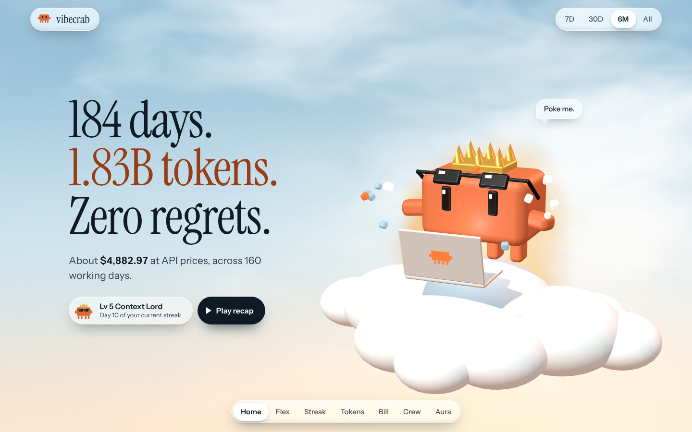

# vibecrab

Your Claude Code usage as a playful, fully local recap. One HTML file, no account, no server.



Sample data in the screenshots.

## Try it

```bash
npx github:Andrea-Gervasoni/claude-usage-dashboard
```

Unofficial, for Claude Code. It reads your usage with [`ccusage`](https://github.com/ryoppippi/ccusage), merges it into `~/.vibecrab/history.json` and opens `~/.vibecrab/index.html`. Run it again whenever you want fresh numbers. Needs Node 18 or newer. Tested on Linux (Chromium). macOS and Windows should work but are not tested yet: the launcher opens the page with `open`, `start` or `xdg-open`, and the CI workflow runs the merge tests on all three. If it fails on your system, `--no-open` prints the page path.

## What you get

- **A recap you can read in ten seconds.** Days, tokens, estimated cost at API prices, per-model split, a month-by-month ledger.
- **Aura levels.** Seven levels computed from your whole history with a formula printed on the page: +1 per million tokens, +50 per day of your longest streak, +10 per active day. Each level unlocks gear for the mascot. Locked levels show what they unlock and how far away they are.
- **Collectible share card.** A 1080×1920 card for stories with your level, aura, four numbers and the repo. One button saves the PNG.
- **Trophies.** Twelve of them, each with a ring that shows your real progress.
- **Story-style recap.** Seven fullscreen slides, tap to advance.
- **The flex.** Rough conversions worth a screenshot, like how many novels of output Claude wrote for you.


## It keeps your history

Claude Code deletes its logs after 30 days by default. Every run merges the daily totals into `history.json` and never removes a day that is already there, so your streaks and totals survive the cleanup.

## Privacy

Everything runs on your machine. The page embeds its data, fonts and 3D library, and makes no network requests. Nothing is uploaded. The share card contains only what you see on it.

## Update every day on macOS

```bash
git clone https://github.com/Andrea-Gervasoni/claude-usage-dashboard.git ~/claude-usage-dashboard
cd ~/claude-usage-dashboard && ./install.sh
```

This installs a LaunchAgent that runs `update.sh` at 23:50 and at login, and keeps the page in the repo folder. `./uninstall.sh` removes it.

## How it is built

| File | Role |
|---|---|
| `bin/vibecrab.mjs` | the one-command launcher |
| `update.sh`, `install.sh` | the macOS scheduled setup |
| `scripts/merge.mjs` | merges a ccusage export into the history, keyed by date |
| `scripts/build.mjs` | template + history + fonts + three.js → one HTML file |
| `sounds/` | audio of the secret clip (see its README for provenance) |
| `template.html` | the page: sky shader, 3D mascot, charts, aura, card, recap |
| `DESIGN.md` | design decisions (Italian) |
| `MARKET.md` | market notes and launch plan (Italian) |

Fonts: Instrument Serif and Instrument Sans (SIL OFL 1.1). 3D: three.js r149 (MIT), bundled.

## Known limits

- The 3D scene and the sky shader are heavy on very old GPUs. Safari is not tested; the glass refraction on the buttons only runs in Chromium, elsewhere it falls back to frosted glass.
- The secret clip is recorded in the browser. Chromium writes VP9/WebM or MP4 with VP9; Instagram and TikTok may refuse some of these. Safari should produce H.264.
- Aura levels use thresholds picked by hand (see the formula on the page). They are a game, not a benchmark, and nothing is compared with other people.
- `sounds/huss.mp3` has no verified license, see `sounds/README.md`. Delete it and the clip uses a synthesized sound.

## Tests

```bash
npm test
```

Runs the history merge tests: days are never deleted, partly deleted days never overwrite fuller ones.

## License

MIT, see [LICENSE](LICENSE). The audio in `sounds/` is not covered.

## Not affiliated

This is an unofficial community project. It is not affiliated with, endorsed by, or sponsored by Anthropic. Claude and Claude Code are trademarks of Anthropic. Costs shown are estimates from ccusage at public API prices.
