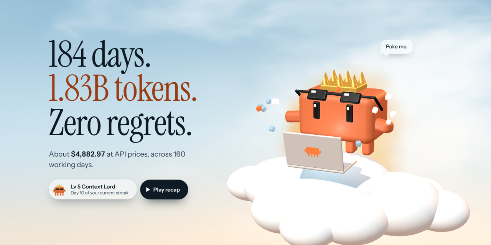
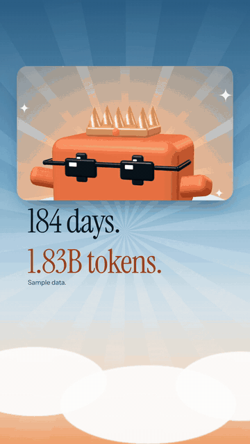
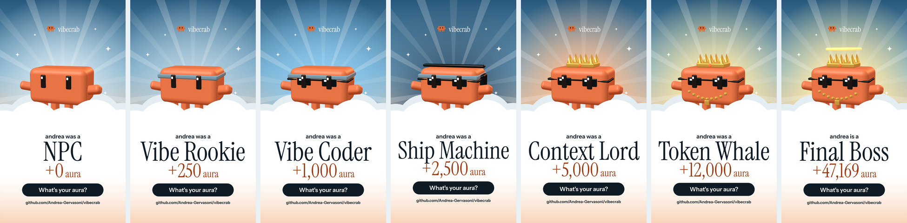

<p align="center">
  
</p>

<h1 align="center">vibecrab</h1>

<p align="center"><b>Your Claude Code year, narrated by a crab.</b><br>
A local recap of your Claude Code usage with a 3D mascot, aura levels, trophies and a card made for stories.</p>

<p align="center">
  <a href="https://github.com/Andrea-Gervasoni/vibecrab/actions/workflows/test.yml"></a>
  <a href="LICENSE"></a>
  
  
  
</p>

<p align="center"><sub>Unofficial. Not affiliated with, endorsed by or sponsored by Anthropic. Nothing leaves your machine.</sub></p>

<p align="center"><a href="https://andrea-gervasoni.github.io/vibecrab/"><b>Try the live demo</b></a> (sample data, no install) · <a href="#run-it">Run it on your own usage</a></p>

<p align="center"></p>

## Run it

```bash
npx github:Andrea-Gervasoni/vibecrab
```

That reads your usage with [ccusage](https://github.com/ryoppippi/ccusage), keeps a permanent history, builds one HTML file and opens it. Needs Node 18 or newer and Claude Code logs on the same machine.

| You want | Run |
| --- | --- |
| Try it with fake numbers | `npx github:Andrea-Gervasoni/vibecrab --demo` |
| Keep the page open and fresh | `npx github:Andrea-Gervasoni/vibecrab --live` |
| Use it from inside Claude Code | `/plugin install vibecrab --marketplace Andrea-Gervasoni/vibecrab`, then run its `vibecrab` command |
| Refresh every night (macOS) | `git clone` this repo and run `./install.sh` |

## What you get

- **A level.** Seven aura levels computed from your whole history, from NPC to Final Boss. The mascot wears the gear you have unlocked.
- **A card for your stories.** A 1080×1920 image with your level and aura. One tap to share or save.
- **Trophies.** Twelve of them, each ring shows your real progress.
- **A recap.** Seven fullscreen slides, like stories, built from your numbers.
- **The numbers.** Days, tokens, estimated cost at API prices, per-model split, a calendar of your streak and a month-by-month ledger.
- **A secret.** Type `huss`, or poke the crab three times.

<p align="center"></p>

## How the aura is computed

No rankings and no comparison with other people: it is a game against your own history.

| | Points |
| --- | --- |
| Every million tokens | +1 |
| Every day of your longest streak | +50 |
| Every active day | +10 |

| Level | Name | From | Unlocks |
| --- | --- | --- | --- |
| 1 | NPC | 0 | |
| 2 | Vibe Rookie | 250 | a headband |
| 3 | Vibe Coder | 1,000 | pixel shades |
| 4 | Ship Machine | 2,500 | headphones |
| 5 | Context Lord | 5,000 | a crown |
| 6 | Token Whale | 12,000 | a gold chain |
| 7 | Final Boss | 30,000 | a halo |

The thresholds are hand-picked. If they feel too easy or too hard on your numbers, [open an issue](../../issues/new?template=feature.yml).

## Put your level in your profile

Every run writes `badge.svg` next to the page (`~/.vibecrab/badge.svg`), and the page has a **README badge** button. Add it to your profile README:

```md

```

## Privacy

| | |
| --- | --- |
| **Reads** | The output of `ccusage`: token counts, costs and model names per day. vibecrab never opens your prompts or code; ccusage itself reads the Claude Code logs on your machine. |
| **Writes** | `~/.vibecrab/`: `history.json`, `index.html`, `badge.svg`. |
| **Sends** | Nothing. The page declares a content security policy that blocks requests to other sites; it has no analytics and no telemetry. |
| **`--live`** | Serves only on `127.0.0.1`, never on your network. |
| **Dependencies** | None. No install scripts. The source is a few hundred lines of Node plus one HTML template. |

The generated HTML contains your usage numbers: think before sending the file to someone. The share card contains only what you see on it.

Claude Code deletes its logs after 30 days by default. Every run merges the daily totals into `history.json` and never removes a day already there, so your streaks and totals survive.

## FAQ

**Is it official?** No. It is an independent project, not affiliated with Anthropic.

**Does it upload anything?** No. You can read `scripts/` and `bin/`. The only programs it starts are `npx ccusage`, `git remote get-url` (to print the repo name on your card) and your system's "open" command to show the page.

**Why is my level low?** The aura is computed on the history vibecrab has seen. Logs older than Claude Code's retention window are gone unless an earlier run saved them.

**Are the costs what I pay?** No. They are estimates from ccusage at public API prices. On a subscription you do not pay that.

**Does it work on Windows and macOS?** The test workflow targets Linux, macOS and Windows. The page itself has been checked on Linux with Chromium; Safari, macOS and Windows are not tested by hand yet. If it breaks for you, please open an issue with the output.

**The video I record will not post.** The browser decides the format. Chromium may write VP9, which some apps refuse. Safari should write H.264.

## Known limits

- The 3D scene and the sky shader are heavy on very old GPUs.
- Glass refraction on the buttons runs in Chromium; elsewhere it falls back to frosted glass.
- `sounds/huss.mp3` has no verified license, see [`sounds/README.md`](sounds/README.md). Delete it and the clip uses a synthesized sound.

## Develop

```bash
npm test                              # history merge, aura, badge
node bin/vibecrab.mjs --demo          # page with sample data
node scripts/pages.mjs                # builds the public demo into ./site
```

| File | Role |
| --- | --- |
| `bin/vibecrab.mjs` | the command: `--demo`, `--live`, `--no-open`, `--help` |
| `scripts/merge.mjs` | merges a ccusage export into the history by date, never deleting a day |
| `scripts/aura.mjs` | levels, formula and badge, shared by the page and the badge |
| `scripts/build.mjs` | template + history + fonts + three.js, into one HTML file |
| `template.html` | the page: sky shader, 3D mascot, charts, aura, card, recap |
| `.claude-plugin/`, `commands/` | the Claude Code plugin |

Contributions are welcome: see [CONTRIBUTING.md](CONTRIBUTING.md).

## Credits and license

MIT, see [LICENSE](LICENSE). Usage data from [ccusage](https://github.com/ryoppippi/ccusage) by ryoppippi. Fonts: Instrument Serif and Instrument Sans (SIL OFL 1.1). 3D: [three.js](https://threejs.org) (MIT). The audio in `sounds/` is not covered by the license.

Claude and Claude Code are trademarks of Anthropic.
